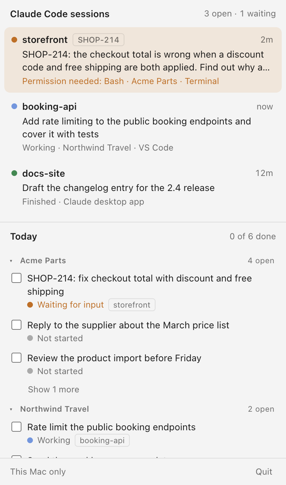

# Rollcall

A Mac menu bar app for keeping track of your Claude Code sessions and the work they are for. It shows every session running on this machine, a to-do list for the day grouped by client, and which sessions are working on which task. A local MCP server gives Claude the same picture, so a chat can answer "what's running, and what haven't I started?"

Everything stays on this Mac. Nothing here makes a network call.



Example data: the sessions, clients and tasks shown are made up.

## What it does

- **Sessions at a glance.** One row per Claude Code session from the terminal, the desktop app and IDE extensions: project, goal, ticket, status and time since last activity. The menu bar icon counts the sessions waiting for you.
- **Notifications.** One notification when a session asks for permission or input. Clicking it, or a row, opens that chat in the Claude desktop app or brings the session's terminal or editor forward.
- **To-dos for the day.** A task list grouped by client. Each task shows the live status of the sessions working on it, so you can see what is in progress, what is waiting on you and what has not been started.
- **MCP server.** `list_tasks`, `list_sessions` and `get_session` expose the same data to any Claude chat, for check-ins and end-of-day summaries.
- **Local only.** Everything is read from Claude Code hooks and stored under `~/.claude-monitor`. The app is read-only towards your sessions: it cannot start, stop or reply to them.

## Run it

```bash
npm install
npm run hooks:install   # adds the hook entries to ~/.claude/settings.json
npm start               # menu bar app
```

Sessions report in from their next event, so restart sessions that were already open or send them a prompt.

| Command | What it does |
| --- | --- |
| `npm start` | Builds and opens the menu bar app |
| `npm test` | Builds and runs the tests |
| `npm run hooks:install` / `hooks:uninstall` / `hooks:status` | Manages the entries in `~/.claude/settings.json` |
| `npm run daemon` | Keeps `sessions.json` current without the menu bar app |
| `npm run mcp` | Runs the MCP server on stdio (Claude starts it for you once registered) |

## To-dos for the day

Below the sessions is a to-do list for the day. Type a task and an optional client, then Add.

- **Grouped by client.** Each client is a group you can minimise or maximise from its heading, which shows how many tasks are open. A group shows three tasks until you press "Show more".
- **Status comes from your sessions.** An open task shows waiting for input, working, finished, idle or not started. With several sessions on one task, the most urgent wins. The session names beside the status open that session.
- **Linking a session to a task.** Automatic when the task title names the session's ticket (`SHOP-123`), or pick the task in the session's Edit form.
- **Clients for projects.** Set a project's client once in a session's Edit form; it applies to every session in that folder.
- **Carry-over.** Open tasks carry over to the next day. Ticked tasks drop off the next day.

Tasks live in `~/.claude-monitor/tasks.json`.

## MCP server

Register it once and any Claude chat can read your sessions and to-dos:

```bash
claude mcp add --scope user rollcall -- node "$(pwd)/dist/src/mcp/server.js"
```

| Tool | Returns |
| --- | --- |
| `list_tasks` | Today's to-dos with client, done or not, and the sessions working on each, plus the running sessions not linked to any task. Optional `client` filter |
| `list_sessions` | Every running session with project, client, task, goal, ticket and status, most urgent first. Optional `status` filter |
| `get_session` | One session by id, or by the start of its id |

Things to ask once it is connected:

- "What sessions do I have running, and which need me?"
- "Which of today's tasks haven't I started?"
- "Summarise what I worked on today, by client."

The server is read-only and runs over stdio with no network access. It folds any events the app has not processed yet, so it answers correctly with the menu bar app closed.

## How it works

1. `~/.claude-monitor/hook.sh` runs on each session event and appends one line to `~/.claude-monitor/events.jsonl`. It takes about 35 ms, prints nothing and always exits 0.
2. The app polls that file twice a second, folds events into one record per session and writes `~/.claude-monitor/sessions.json`.
3. The popover and the MCP server read that state. Goal, ticket, client and project-name edits live in `overrides.json`, and to-dos in `tasks.json`.

| Event | Status |
| --- | --- |
| `SessionStart` | idle until the first prompt ("No prompt yet") |
| `UserPromptSubmit`, `PostToolUse`, `PostToolUseFailure` | working |
| `PermissionRequest`, `Notification` (permission, elicitation, background agent), `PreToolUse` for `AskUserQuestion` / `ExitPlanMode` | waiting for input |
| `Stop`, `StopFailure` | finished |
| `SessionEnd` | removed |
| No event for 30 minutes | idle (a session waiting on you keeps saying so) |
| No event for 12 hours | dropped |

## Settings

Optional `~/.claude-monitor/config.json`:

```json
{ "idle_minutes": 30, "drop_after_hours": 12, "rotate_mb": 5, "ticket_prefixes": ["SHOP", "BLOG"] }
```

With `ticket_prefixes` empty, any `ABC-123` key is detected from the branch name, then the first prompt.

## Layout

| Path | Contents |
| --- | --- |
| `src/hook/hook.ts` | The hook. Self-contained, Node built-ins only |
| `src/cli/install.ts` | Installer and uninstaller for the settings entries |
| `src/shared/fold.ts` | Pure event-to-status rules |
| `src/shared/store.ts` | Event log reading, rotation, `sessions.json`, edits |
| `src/shared/tasks.ts` | To-dos and the rule that links sessions to them |
| `src/shared/transcript.ts` | The only code that reads the undocumented transcript format |
| `src/mcp/server.ts` | MCP server |
| `src/app/desktop.ts` | Opens a session's chat in the Claude desktop app (undocumented link) |
| `src/app/`, `ui/` | Electron menu bar app |

## Licence

MIT. See [LICENSE](LICENSE).
